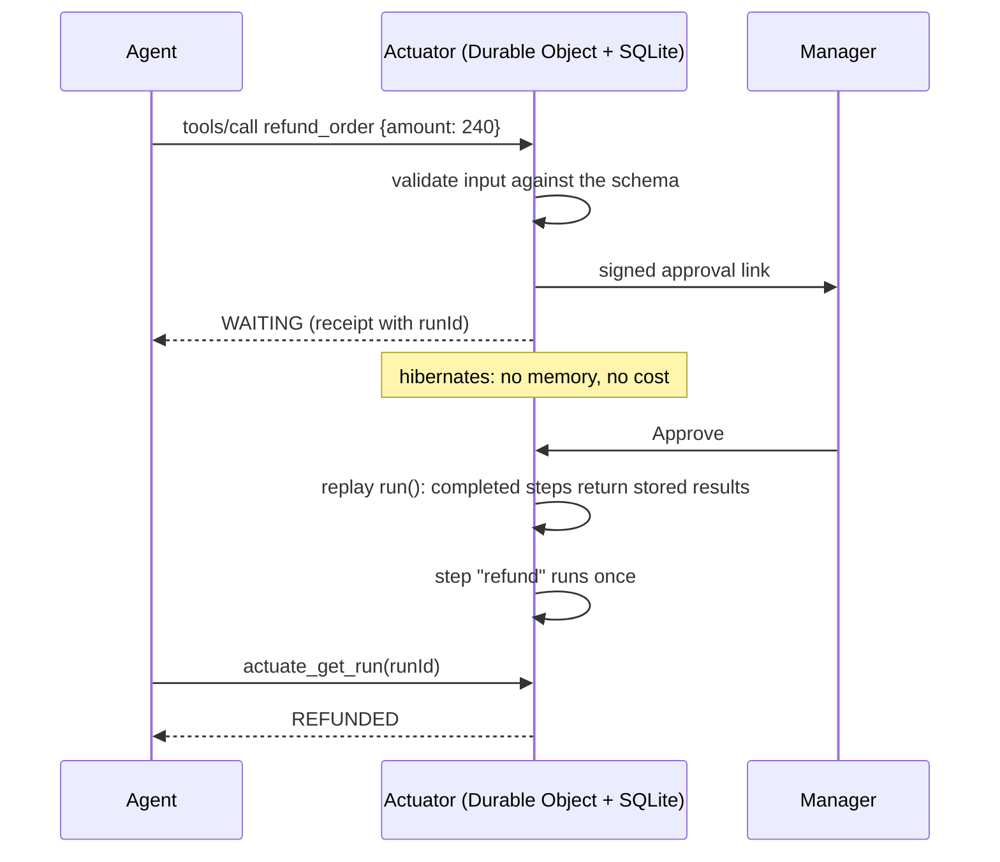

<p align="center">
  <a href="https://actuate.run">
    <picture>
      <source media="(prefers-color-scheme: dark)" srcset=".github/assets/banner-dark.png" />
      
    </picture>
  </a>
</p>

<p align="center">
  <a href="https://actuate.run">Website</a> ·
  <a href="https://actuate.run/docs">Docs</a> ·
  <a href="https://actuate.run/docs/getting-started/quickstart/">Quickstart</a> ·
  <a href="https://github.com/actuate-run/templates">Templates</a> ·
  <a href="https://actuate.run/docs/guides/self-hosting/">Self-hosting</a>
</p>

<p align="center">
  <a href="LICENSE"></a>
  
  
  
</p>

**Actuate turns one TypeScript file into a tool your AI agent can call over MCP or HTTP.** The tool checks its input against a schema, runs each step exactly once, sleeps for days at no cost, waits for payments, replies or a person's approval, and keeps its own SQLite database. Your messaging, payment and LLM keys stay out of the prompt.

```bash
npm create actuate
```

## Example

A refund tool an agent can't misuse: amounts are capped by the schema, anything above RM 100 waits for a manager, and a retried call never refunds twice.

```ts
import { defineActuator, z } from "@actuate/sdk";

export default defineActuator({
  name: "refund_order",
  description: "Refund an order. Above RM 100 a manager approves first. Each order is refunded once.",
  input: z.object({ orderId: z.string(), billId: z.string(), amount: z.number().positive().max(500) }),
  capabilities: ["payment", "messaging"],
  async run(ctx, input) {
    if (input.amount > 100) {
      // The run pauses here (for hours if it must) until the manager taps a signed link.
      const decision = await ctx.step.waitForApproval("manager", {
        message: `Refund RM ${input.amount} for order ${input.orderId}?`,
        notify: "@shop_manager",
        timeout: "24 hours",
      });
      if (!decision?.approved) return { status: "DECLINED", note: decision?.note ?? "timed out" };
    }
    // A step runs once. If the agent retries, it gets this result back, not a second refund.
    const refund = await ctx.step.do("refund", ({ idempotencyKey }) =>
      ctx.payment.refund!({ billId: input.billId, amount: input.amount, idempotencyKey }),
    );
    return { status: "REFUNDED", refundId: refund.id };
  },
});
```

Run it locally with `npx actuate dev`, deploy it with `npx actuate deploy`, then give it to your agent:

```bash
claude mcp add --transport http refund_order https://run.actuate.run/a/<actuator-id>/mcp \
  --header "Authorization: Bearer <agent token>"
```

Any MCP client works: Claude Code, Claude Desktop, Cursor, VS Code, or your own agent through an MCP SDK. Each actuator also has an HTTP endpoint and an OpenAPI document. See [Connect your agent](https://actuate.run/docs/guides/connect-your-agent/).

## What you get

- **Exactly once.** `ctx.step.do` journals each step. Replays and retried tool calls get the stored result back.
- **Free waits.** `sleep`, `sleepUntil` and `waitForEvent` hibernate the run. Nothing runs, and nothing is billed, until it wakes.
- **People in the loop.** `waitForApproval` and `waitForInput` send a signed, single-use link and resume when someone answers.
- **Its own database.** A SQLite database per actuator, with parameterised queries, migrations, and CSV and `.sql` export.
- **Your accounts.** Telegram, WhatsApp, Slack, Discord and email; Stripe, Chip, ToyyibPay and Billplz; Anthropic, OpenAI, Google or any OpenAI-compatible API. Credentials are yours and never reach the model.
- **Schema-checked tools.** Input is validated before anything runs; MCP tools and OpenAPI are generated from your Zod schemas.
- **Replay-safe by lint.** `actuate check` flags network calls, provider calls, clocks and randomness outside a step before you deploy.
- **Open source.** The SDK, runtime, CLI and provider adapters are Apache-2.0. Self-host on Cloudflare Workers, or use the hosted platform at [actuate.run](https://actuate.run).

## How it works

`run` is replayed from the top whenever the run resumes. Completed steps return their stored result instead of running again, so the code reads top to bottom while the run itself survives restarts, retries and days of waiting.



Each actuator is a Durable Object with its own SQLite database. Steps are journaled in `_actuate_steps`; sleeps and waits set an alarm or a waiting row and end the invocation. Because of replay, anything with a side effect (network, provider calls, writes, `Date.now()`) belongs inside `ctx.step.do`: provider calls outside a step throw at runtime, and `actuate check` catches the rest. Details: [Steps and replay](https://actuate.run/docs/concepts/steps-and-replay/).

## Packages

| Package | What it is |
| --- | --- |
| [`@actuate/sdk`](packages/sdk) | `defineActuator`, `ctx.step.*`, `ctx.db`, provider types |
| [`@actuate/runtime`](packages/runtime) | The step engine: journal, replay, sleeps, events, approvals and input links. Runs on `workerd` with SQLite |
| [`@actuate/cli`](packages/cli) | The `actuate` command: `init`, `dev`, `check`, `deploy`, `run`, `logs`, `login`, `providers` |
| [`@actuate/providers`](packages/providers) | Bring-your-own-credentials adapters for messaging, payments and LLMs |
| [`create-actuate`](packages/create-actuate) | `npm create actuate`, with [11 templates](https://github.com/actuate-run/templates) |

## Hosted or self-hosted

- **Hosted, at [actuate.run](https://actuate.run):** `npx actuate deploy`, a dashboard with runs, approvals and tables, MCP for your agents, and plans with hard monthly limits (no surprise bills). Free Sandbox plan.
- **Self-hosted:** the open-source runtime runs an actuator as a Worker plus a SQLite-backed Durable Object, on Cloudflare or plain `workerd`, with no Actuate account. See [Self-hosting](https://actuate.run/docs/guides/self-hosting/).

## Contributing

Issues and pull requests are welcome. See [CONTRIBUTING.md](CONTRIBUTING.md) for setup and conventions; security reports go through [SECURITY.md](SECURITY.md), not public issues.

```bash
pnpm install
pnpm check   # build, typecheck and test: unit tests on node:sqlite, end to end on workerd via Miniflare
```

Requires Node.js 22 or later and pnpm 10.

## License

[Apache-2.0](LICENSE)
